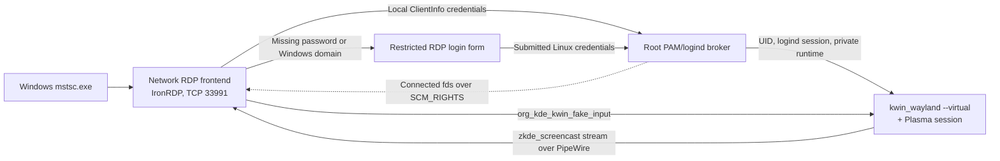

# Architecture and delivery gates

The target is a login-independent remote desktop: the PC stays awake, a
system-level broker creates a session without any local login, and a dedicated
stock **KWin 6** process on its virtual backend renders a Plasma desktop while
the physical display is off or disconnected. KDE-RDP is a port of Niri-RDP,
which used a patched headless Niri. The bridge, broker, audio, microphone,
clipboard, login form, NVENC and packaging are reused; the compositor layer was
replaced. The port's design contract is [kde-port.md](kde-port.md). Measured
KWin 6.8.2 behavior, with sources and lab reproduction, is in
[KWin findings](kde-findings.md). Authentication and library choices are in
[login and RDP research](login-and-rdp.md). The Niri-era evidence is in
[Niri findings](niri-findings.md) and older [validation](validation.md) entries.



The frontend (`kde-rdp-frontend`, the `bridge/` binary, running as the
unprivileged `kde-rdp` account) owns TLS, library-managed RDP negotiation,
codecs, input translation and limits. The privileged broker
(`kde-rdp-broker`) owns account authorization and session lifetime. It accepts
no executable, arguments, environment, socket path or output size from the
client. KWin owns output rendering and input routing. The bridge only uses
connections the broker hands it for that session, never inherited local desktop
sockets. The virtual output stays powered and scheduled when physical outputs
are absent; this does not change or turn off the local desktop.

## Session chain

```
kde-rdp-broker (root; PAM, logind, per-UID lock)
 └─ dbus-run-session -- /usr/lib/kde-rdp/session-worker     (user, private bus)
     ├─ session-audio, session-microphone                    (private PipeWire)
     └─ kwin_wayland --virtual --xwayland --no-lockscreen --socket wayland-0
            --width W --height H --exit-with-session=/usr/lib/kde-rdp/session-plasma
               └─ plasma_session: ksmserver, plasmashell, kded, portals, autostart
```

- `XDG_RUNTIME_DIR` is the broker's private desktop directory
  (`KDE_RDP_RUNTIME_DIR`, mode 0700, owned by the account). KWin's socket is
  `$priv/wayland-0`, and PipeWire's is `$priv/pipewire-0`. logind keeps its
  genuine `/run/user/UID` registration, but the desktop never uses that
  directory's sockets.
- The host's systemd user units for Plasma are not used: the remote desktop
  must not touch the user manager it shares with local logins. Without systemd
  startup, `session-plasma` exports the activation environment to the private
  bus and owns `org.kde.KWinWrapper` before it runs `plasma_session`. Otherwise
  Plasma starts a nested second KWin, and D-Bus-activated services start without
  `WAYLAND_DISPLAY` ([findings §5](kde-findings.md#5-plasma-launch-without-systemd)).
- W×H is the client's requested desktop size when the broker knows it, else
  1920×1080. The output name is whatever KWin reports (`Virtual-0` today);
  `KDE_RDP_OUTPUT` can select one by name.
- Rootless container tools need the genuine runtime and systemd user bus:
  podman keeps its user namespace (`libpod/tmp/pause.pid`) under
  `XDG_RUNTIME_DIR` and creates scopes through the user manager, so with the
  private values it would start a second, empty namespace. `session-worker`
  puts `/usr/lib/kde-rdp/containers` first on `PATH`; its `podman`, `buildah`,
  `toolbox` and `docker` links run `session-containers`, which, only when the
  private runtime is in effect and `/run/user/UID` is owned by the account,
  sets `XDG_RUNTIME_DIR` and `DBUS_SESSION_BUS_ADDRESS` to `/run/user/UID` and
  its `bus`, rewrites a `DOCKER_HOST` pointing at the private `docker.sock`,
  drops itself from `PATH` and execs the real tool. The desktop itself keeps its
  private runtime and bus. distrobox is not linked: it forwards its whole
  environment into the container, and its podman calls (also from exported
  launchers running `/usr/bin/distrobox-enter`) resolve to the podman link.
  For podman `exec`, `run` and `create`, the shim rewrites `-e`/`--env` values
  between the subcommand and the container or image name that equal or lie
  under the private runtime (also as `unix:`, `unix:path=` or `unix://`
  addresses) to the same path below `/run/host`, the host root inside distrobox
  and toolbox containers, so Wayland, PipeWire and Pulse reach the remote
  desktop; the private bus and X11 sockets are in `/tmp`, which distrobox
  shares. For toolbox the shim keeps the desktop's bus and its own directory on
  `PATH` (toolbox's podman calls come back through it) and makes a relative
  `WAYLAND_DISPLAY` absolute so it is rewritten too (untested).
- `session-worker` writes a session-only `XDG_CONFIG_DIRS` overlay that
  disables KWin's shake-cursor effect. That effect paints an enlarged cursor
  into screencast frames and hides the cursor metadata. The account's
  `~/.config` is not modified.
- The session ends when KWin exits. Plasma logout makes KWin exit with status 0,
  and the worker then stops its audio helpers.

## Broker-to-frontend handoff

After authorization, a short-lived child running as the session user connects
to `wayland-0`, `pipewire-0`, `audio-0` and the optional `audio-in-0`, and the
broker passes those fds to the frontend over SCM_RIGHTS, in that order. Each
fd is sent only together with all the earlier ones. Only the compositor fd is
required: a missing audio or microphone helper never rejects an authenticated
resume, and every reconnect receives fresh fds. The frontend never opens
user-owned paths itself. The wire format is "Wire contract v3" in
[broker/README.md](../broker/README.md#wire-contract-v3), implemented in
`bridge/src/broker.rs`.

Two KWin and PipeWire behaviors decide this design:

- **KWin 6.8.2 has no executable or `.desktop` grant.** It hides the
  restricted interfaces (`org_kde_kwin_fake_input`,
  `zkde_screencast_unstable_v1`, `ext_data_control_manager_v1` and others) only
  from sandboxed clients. A client is sandboxed when it connects through a
  `wp_security_context_v1` listener, or when the connecting pid runs in an
  `app-flatpak-*` or `snap.*` user unit. The handed-off connection qualifies
  for neither, so no `.desktop` file is installed. The connector must never run
  in such a unit, and the bridge must not use a security-context listener. Any
  process of the session user can inject input and capture the screen, as on an
  ordinary Plasma session
  ([findings §1](kde-findings.md#1-authorization-no-desktop-grant-exists-in-682)).
- **PipeWire classifies an fd whose connector has exited as `flatpak`**, which
  cannot see KWin's node. `session-audio` therefore sets `access.socket` to
  `unrestricted` for `pipewire-0` in the private PipeWire configuration. The
  socket is inside the 0700 private runtime directory.

## Compositor interfaces

| Need | KWin interface | Bridge code |
| --- | --- | --- |
| Frames and damage | `zkde_screencast_unstable_v1.stream_output` → PipeWire node; MemFd SHM, or NVIDIA block-linear DMA-BUF imported by NVENC | `bridge/src/screencast.c`, `bridge/src/wayland/` |
| Cursor | PipeWire `SPA_META_Cursor` (metadata mode); embedded mode for clients without pointer support | `wayland/cursor.rs` |
| Keyboard and pointer | `org_kde_kwin_fake_input` v6: evdev keycodes, `keyboard_keysym` for Unicode, global logical coordinates | `wayland/kwin_input.rs` |
| Resize | Renegotiate the screencast stream size; KWin resizes the virtual output to match | `screencast.c` (`pw_stream_update_params`) |
| Output discovery | `kde_output_device_registry_v2` (name, scale, position) | `wayland/protocols.rs` |
| Clipboard | `ext_data_control_v1` | `clipboard.rs` |

The rules come from the measurements in [kde-findings.md](kde-findings.md):

- KWin sends no frames while the desktop is idle and up to 60 fps while
  something animates. Cursor-only buffers are marked
  `SPA_CHUNK_FLAG_CORRUPTED` even though their chunk size stays the full frame
  size: the bridge tests the flag, not the size.
- Target the stream with the zkde `serial` event (`PW_KEY_TARGET_OBJECT`), not
  the node id.
- **Resize only by renegotiating the stream.** Never apply
  `kde_output_management_v2` modes. After a management apply, KWin pins that
  mode, and later stream-driven resizes stop working. Offer the desired desktop
  size as the initial default, because the consumer's first offer also sizes the
  output.
- Bind one `fake_input` for the whole session. The virtual seat has pointer
  capability only while one is bound, and destroying it releases held keys and
  buttons. Wheel input uses 10 axis units per RDP notch, because fake input
  carries no value120.

## GPU requirement

`stream_output` works only with OpenGL compositing. KWin's software device needs
`/dev/udmabuf`, which uaccess grants only to the active local seat user, so a
remote session has no software path. `session-worker` requires a read-write
render node (`/dev/dri/renderD*`) and warns when NVIDIA's `/dev/nvidia*` nodes
are inaccessible. `renderer.conf` accepts only `auto` or `hardware`. KWin never
scans out here: card nodes, DRM master and `KWIN_DRM_DEVICES` do not apply.
GPU-less hosts and non-GPU CI cannot run the screencast; the lab fixtures use
the host's render node only ([findings §6](kde-findings.md#6-gpu-path-nvidia-render-node-only)).

## Port status and gates

| Area | Acceptance gate | Current evidence |
| --- | --- | --- |
| KWin capture, input, resize and clipboard | Frames, damage, cursor, input and stream-driven resizes on `kwin_wayland --virtual` in disposable sandboxes | Lab probes and bridge integration passed on KWin 6.8.2 with the NVIDIA render node, 2026-11-03, including FreeRDP bitmap, NVENC SHM and DMA-BUF NVENC ([validation](validation.md#kde-port-bridge-capture-on-kwin-682-2026-11-03)) |
| Broker handoff | The frontend captures over the broker's handed-off `pipewire-0` from an exited connector | Implemented (`access.socket` in `session-audio`); the lab bridge connected PipeWire itself, so the handoff is not yet validated end to end |
| Plasma session | A full Plasma desktop under the private bus without systemd user units; logout ends KWin cleanly | Lab Plasma launch with the session-holder prototype; an installed-host session has not been validated |
| Installed host | Fresh boot with no local login; valid credentials create a remote KWin session; invalid credentials and launch or crash failures leave no resources; reconnect within the grace window resumes | Inherited from Niri-RDP and not yet repeated on KWin; see [acceptance](acceptance.md) |
| Windows clients | `mstsc.exe` desktop, input, audio, clipboard, microphone, resize, power-off and unplug regressions | Confirmed on Niri-RDP; not yet repeated on KWin |

Package availability does not promote these gates to complete. Keep new
integration work in disposable sandboxes (`lab/kwin/`) or a dedicated test
account. Do not replace the host's KWin or Plasma packages, display manager,
PAM stack or working desktop. Monitor power-off is distinct from system
suspend: test display power and disconnect while the machine stays awake, and
leave the host's power policy unchanged.

## Upstream boundary

Stock KWin already provides the virtual backend, screencast, fake input and
data control this port needs, so no compositor patches are carried. Upstream
work should be driven by a measured failing case, such as the missing value120
on fake-input wheel events or the output-management/stream-resize conflict,
rather than by recreating features in the bridge. IronRDP's pinned revision
provides credential validation and post-authentication desktop binding; FreeRDP
remains an alternative if a measured Windows or security requirement makes it
preferable.

## Authentication and session policy

Accounts must have UID >= 1000, a login shell and membership in
`kde-rdp-users`; root and the frontend account are rejected. Simultaneous local
graphical sessions for the same account are rejected. Broker-mode disconnect
preserves the desktop for a grace window (`grace_seconds` in
`/etc/kde-rdp/broker.conf`, default 45 seconds) after broker-observed
detachment; expiry fully logs out and cleans up the session. Fresh PAM
authentication, account checks and group authorization permit resuming that
same desktop, excluding its own logind session from the check. Logout, KWin
exit or broker shutdown ends it. Per-session private D-Bus and unique sockets
help, but the systemd user manager, user files, portals and application
single-instance behavior are shared with the account's other logins. A second
desktop under the same UID is not independent security isolation.

NLA/CredSSP authentication and PAM password checks are distinct mechanisms.
Broker mode uses TLS-only RDP, because PAM passwords cannot supply the static
NTLM credential the library's default NLA backend needs; Windows policies that
require NLA are incompatible. The installed frontend listens on `0.0.0.0:33991`
by default; an explicitly configured loopback listener remains available, and
disposable test mode is loopback-only. Missing passwords or remembered Windows
domain credentials open a restricted login form. Only PAM acceptance creates a
Linux desktop and session.
